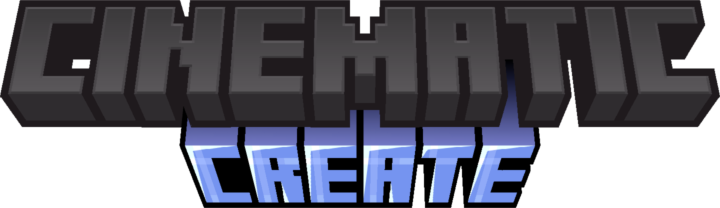
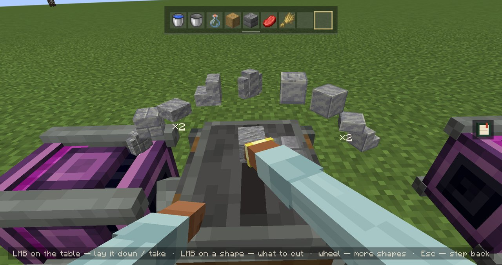
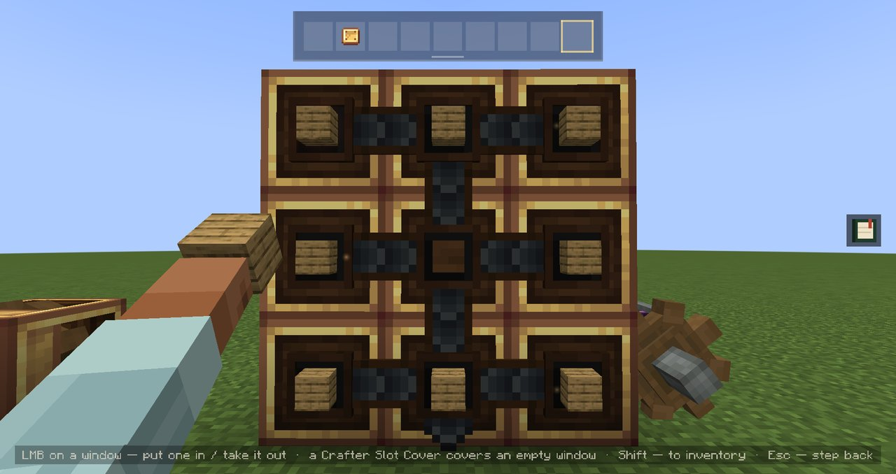
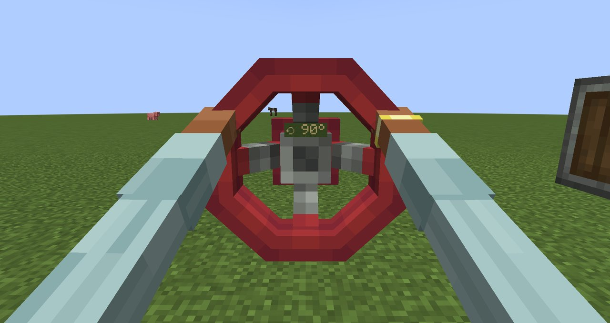
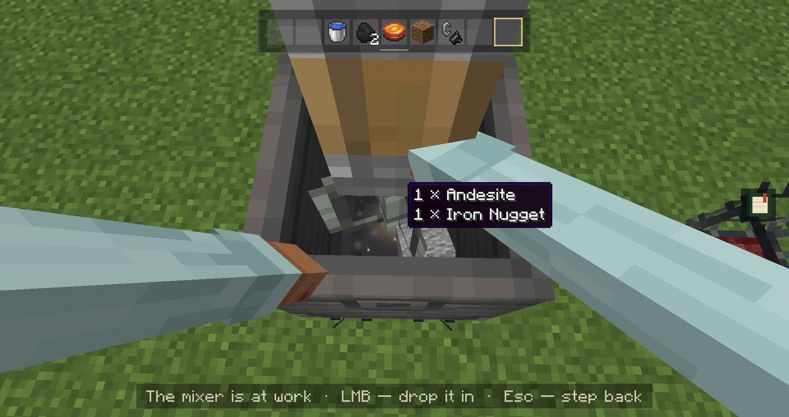
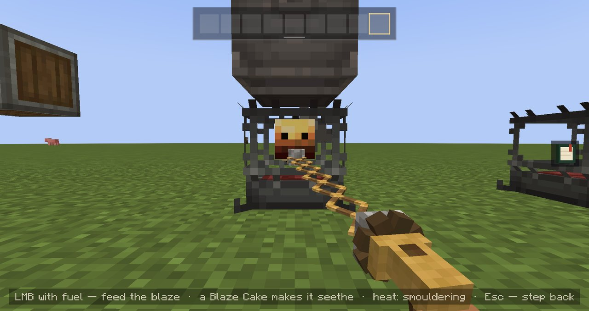

  

  <b>Work Create's machines with your own two hands.</b> 
  An add-on for Cinematic Interactions · Minecraft 1.21.1 · NeoForge · Create 6.0

---

[Cinematic Interactions](https://github.com/dcvke/CinematicInteractions) turned vanilla's workstations into little first-person scenes. This add-on does the same for **Create**: right-click a machine and you work it with your own hands, in time with the machine itself.

  

## What you can do

- Lay an ingot on a depot and watch the press come down on it
- Fill a wall of Mechanical Crafters window by window, up to 10×10
- Turn a Valve Handle or a Hand Crank with both hands
- Drop, pour and mix in a basin, feed a Blaze Burner
- Pick a shape on the saw's dial, pour grain into a millstone
- Hand items to a deployer, follow an ejector's throw
- Spouts, fans and item drains too

<table>
  <tr>
    <td width="50%"> Mechanical Crafters</td>
    <td width="50%"> Valve Handle</td>
  </tr>
  <tr>
    <td width="50%"> Basin</td>
    <td width="50%"> Extendo Grip</td>
  </tr>
</table>

## Good to know

- It's all Create underneath: same recipes, same results, and your wrench, goggles and filters work as always.
- Holding an Extendo Grip? Work from a distance and let the grip do the reaching.
- Rather click some machines the plain way? Each one can start on right-click, only with a key (**H**), or never.
- On a server without the mod, client mode still gives you a lighter version.
- Pack makers can fine-tune where the hands work in every scene, with an editor in Cinematic Interactions' style.

## Requirements

- Minecraft 1.21.1 with NeoForge
- [Create](https://github.com/Creators-of-Create/Create) 6.0.10 or newer
- [Cinematic Interactions](https://www.curseforge.com/minecraft/mc-mods/cinematic-interactions) 0.18.28 or newer

Install it on both the server and the client.

## Credits

Built on [Cinematic Interactions](https://github.com/dcvke/CinematicInteractions) by Southware, for [Create](https://github.com/Creators-of-Create/Create) by simibubi and the Creators of Create. Made by **JS_ON**. [MIT license](LICENSE.txt).
